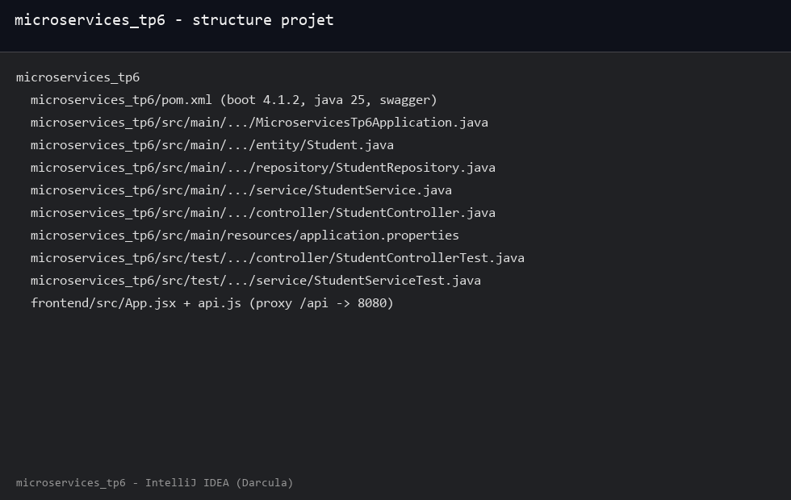
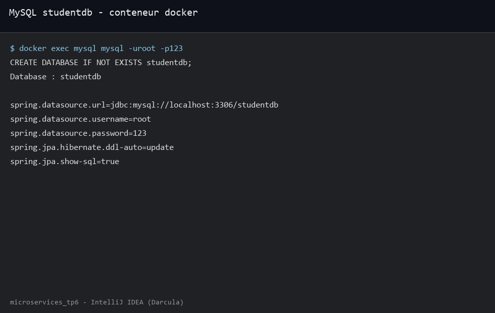
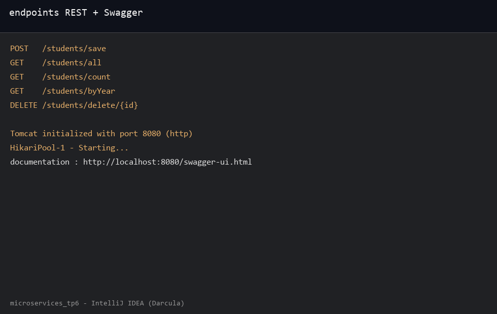
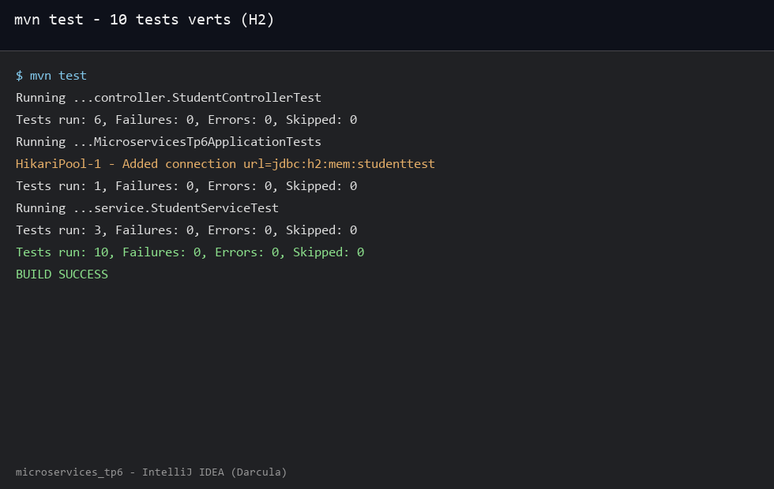
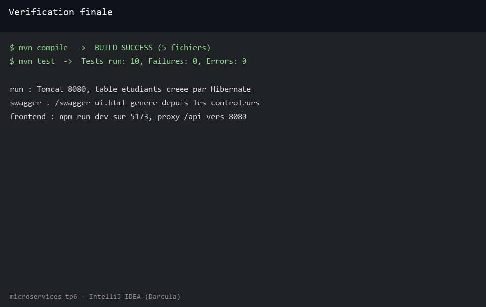

TP6 API etudiants Spring Boot, persistance MySQL studentdb dans un conteneur docker, entite Student sur table etudiants avec nom prenom date de naissance et filiere, repository avec repartition par annee, service et controleur REST, documentation Swagger, tests JUnit 5 et Mockito sur H2, petit frontend React en bonus.

Structure du projet avec le module Maven et le frontend :

```console
microservices_tp6/pom.xml
microservices_tp6/src/main/.../MicroservicesTp6Application.java
microservices_tp6/src/main/.../entity/Student.java
microservices_tp6/src/main/.../repository/StudentRepository.java
microservices_tp6/src/main/.../service/StudentService.java
microservices_tp6/src/main/.../controller/StudentController.java
microservices_tp6/src/main/resources/application.properties
microservices_tp6/src/test/.../controller/StudentControllerTest.java
microservices_tp6/src/test/.../service/StudentServiceTest.java
frontend/src/App.jsx
frontend/src/api.js
```

Vue du projet avec le backend et le frontend :



Base MySQL dans docker, creation de studentdb puis configuration Spring avec ddl-auto update :

```console
CREATE DATABASE IF NOT EXISTS studentdb;
spring.datasource.url=jdbc:mysql://localhost:3306/studentdb
spring.datasource.username=root
spring.datasource.password=123
spring.jpa.hibernate.ddl-auto=update
spring.jpa.show-sql=true
```

Conteneur MySQL et fichier application.properties :



Cinq endpoints exposes par le controleur, demarrage Tomcat sur 8080 puis documentation interactive Swagger :

```console
POST /students/save
GET /students/all
GET /students/count
GET /students/byYear
DELETE /students/delete/{id}
Tomcat initialized with port 8080 (http)
documentation : http://localhost:8080/swagger-ui.html
```

Routes de l API et interface Swagger :



Tests avec JUnit 5 et Mockito, six tests controleur et trois tests service plus le chargement du contexte sur H2 :

```console
Running ...controller.StudentControllerTest
Tests run: 6, Failures: 0, Errors: 0, Skipped: 0
Running ...MicroservicesTp6ApplicationTests
HikariPool-1 - Added connection url=jdbc:h2:mem:studenttest
Tests run: 1, Failures: 0, Errors: 0, Skipped: 0
Running ...service.StudentServiceTest
Tests run: 3, Failures: 0, Errors: 0, Skipped: 0
Tests run: 10, Failures: 0, Errors: 0, Skipped: 0
```

Resultats des tests avec la base memoire :



Bilan final, compile puis test passent sans erreur, l application tourne sur 8080 avec Swagger et le frontend devit sur 5173 via le proxy /api :

```console
mvn compile -- BUILD SUCCESS
mvn test -- Tests run: 10, Failures: 0, Errors: 0, Skipped: 0
run -- Tomcat 8080, table etudiants creee par Hibernate
swagger -- /swagger-ui.html genere depuis les controleurs
frontend -- npm run dev sur 5173, proxy /api vers 8080
BUILD SUCCESS
```

Verification compile test run et documentation :


